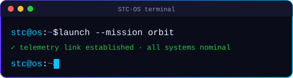

<div align="center">



<a href="https://spacetc.ru"></a>

<br/>

[](https://spacetc.ru)
[](https://spacetc.ru)
[](https://spacetc.ru)
<br/>
[](https://discord.gg/XYNdJjwVCY)
[](https://t.me/spacetc_official)
[](https://vk.ru/spacetc_official)

</div>



<p align="center"></p>

```ansi
[1;35m┌──[ 𝚂.𝚃.𝙲 · OS v1.0 ]──────────────────────────────────────────┐[0m
[1;36m stc@station[0m:[1;34m~[0m$ status --all
  [32m●[0m  СТАНЦИЯ ............................ [1;32mONLINE[0m
  [32m●[0m  СЕКТОР EARTH (Vanilla+) ............ [1;32mОТКРЫТ[0m
  [33m◌[0m  ДАЛЬНИЕ ПЛАНЕТЫ ................... [1;33mСПРОЕКТИРОВАНЫ[0m
  [31m✕[0m  ТОКСИЧНОСТЬ ....................... [1;31mНЕ ОБНАРУЖЕНА[0m
  [36m⟡[0m  АДРЕС ............................. [1;36mplay.spacetc.ru[0m
[1;36m stc@station[0m:[1;34m~[0m$ motd
  [37mЗашёл, выдохнул, побыл собой.[0m
[1;35m└────────────────────────────────────────────────────────────────┘[0m
```

## 🛰️ О станции

**Space Technology Corporation** — Minecraft-проект, задуманный как место для отдыха. Не гонка, не работа, не обязательства. **Без токсичности и давления.** Без ощущения, что игра превращается во вторую смену.

Мы не гонимся за онлайном и не пытаемся впечатлить цифрами. Нам важно, чтобы людям было хорошо. Если хорошо — они остаются. Если остаются — проект живёт. Всё остальное приложится.

<table>
<tr>
<td width="50%" valign="top">

### 🌍 Earth — открыт
**Vanilla+.** Знакомые механики и немного больше. Мир, в котором можно строить, исследовать, копать вглубь, уходить к горизонту. Играть так, как хочется.

</td>
<td width="50%" valign="top">

### 🪐 Дальше — засекречено
Earth — только стартовая площадка. Тихий уголок перед тем, что уже спроектировано, но ещё не показано. Другие планеты. Другие условия. Свои механики.

</td>
</tr>
</table>

<details>
<summary><b>📡 [ПЕРЕХВАЧЕННАЯ ПЕРЕДАЧА · уровень доступа: ограничен]</b></summary>
<br/>

> `>>> канал 07 · шифр частично снят`
>
> Название **Space Technology Corporation** появилось не просто так. За ним стоит структура, которая уже продумана: роли, лор, механики.
>
> Дальше будут другие планеты. Другие условия. Другая атмосфера. И не только она.
> В проекте найдётся место и для того, что **лучше не встречать в одиночку**.
>
> `>>> [ДАННЫЕ УДАЛЕНЫ] · координаты следующей точки ██████ · ███ ██████`
>
> Но об этом позже. Пока рано.

</details>


## ⚙️ Системы на борту

Это организация, в которой мы разрабатываем и поддерживаем **сервера проекта Space Technology Corporation**. Здесь живут плагины, моды, конфигурации, инфраструктура и внутренние инструменты — всё, что стоит за станцией. То, что игрок видит как «просто мир», на деле проходит через чертежи, ночи без сна и много ручной работы.

<div align="center">

| Модуль | Назначение | Статус |
|:--|:--|:-:|
| ☯️ **Karma** | Репутация игрока: поступки имеют вес | 🟢 |
| ⛏️ **Mining** | Переосмысленная добыча — глубже, интереснее | 🟢 |
| ☄️ **Meteors** | Небесные гости с ценным грузом | 🟢 |
| 🛡️ **Moderation** | Спокойный порядок без лишнего шума | 🟢 |
| 🏕️ **SafeZone** | Территории, где можно просто выдохнуть | 🟢 |
| 💬 **Chat** | Связь на борту — аккуратно и красиво | 🟢 |
| 👁️ **Anti-Xray** | Честная руда для честных шахтёров | 🟢 |
| 📉 **Lag-Detect** | Ловит лаги раньше, чем их заметишь ты | 🟢 |
| 💠 **Donate** | Поддержка проекта без pay-to-win | 🟢 |
| 🏷️ **Tags** | Знаки отличия экипажа | 🟢 |
| 🪑 **Sit** | Присесть и посмотреть на закат | 🟢 |
| 🤖 **Discord Bot** | Мост между станцией и сообществом | 🟢 |
| 🌐 **Site** | Внешний шлюз — [spacetc.ru](https://spacetc.ru) | 🟢 |

<sub>Всё написано своими руками. Мы не выкладываем сырое и не обещаем того, чего нет. Всему своё время.</sub>

</div>


## 🧑‍🚀 Набор в экипаж

Раз ты зашёл сюда, значит знаешь, что такое GitHub. Значит, чем-то тебя заинтересовало то, что мы делаем. Возможно, ты уже догадываешься, куда ведут следующие двери. Или нет.

Если ты чувствуешь, что хочешь быть частью этого — не наблюдателем, а тем, кто болеет проектом, — мы будем рады посмотреть твоё резюме.

<div align="center">

[](mailto:job@spacetc.ru)

<sub>Мы рассмотрим каждое. Спокойно, без спешки. Как и всё, что мы делаем.</sub>

</div>

<br/>

> Мне нужны те, кто чувствуют. Или никто.
> Лучше одному тянуть, чем тащить за собой балласт,
> который в решающий момент отвернётся.

<div align="center">

**Добро пожаловать на станцию 𝚂.𝚃.𝙲.**

*Директор 𝚂.𝚃.𝙲*


</div>
